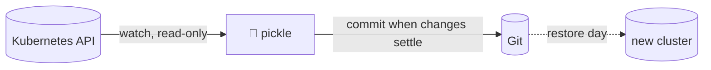

<div align="center">

# 🥒 pickle

**Your cluster, preserved in a jar.**

Pickle watches every object in your cluster and keeps a clean, re-appliable copy of it in Git.

[](https://github.com/hatam-abolghasemi/pickle/actions/workflows/ci.yml)


</div>

## Why

GitOps tells the cluster what to be. Nothing tells Git what the cluster *actually is*.

A 3 AM `kubectl edit`, twelve Helm defaults nobody wrote down, a webhook an operator created: when the cluster is gone, so are they. Pickle keeps all of it as plain YAML you can read, diff, review and `kubectl apply`.

## What you get

```text
stg/
├── _cluster/
│   ├── namespace-payments.yaml
│   └── storageclass-ceph-rbd.yaml
└── payments/
    ├── _secrets-referenced.txt
    ├── configmap-payments-config.yaml
    └── deployment-payments-api.yaml
```

Each file is stripped of runtime noise and says who touched it last:

```yaml
# last-manager: kubectl-edit (Update)
# last-changed: 2026-10-14T03:12:41Z
# argocd-app: payments-api
apiVersion: apps/v1
kind: Deployment
...
```

A `kubectl-edit` on an Argo-managed object is a hotfix, and now you have receipts:

```text
[stg] 1 added, 1 modified
A payments/configmap-hotfix-whitelist.yaml  [kubectl-client-side-apply]
M payments/deployment-payments-api.yaml     [kubectl-edit]
```

## How it works



One watch per resource type, plus a slow, rate-limited backfill of what already exists. Nothing polls: commits happen when changes settle, and new CRDs are picked up the moment they appear. Status updates never cause commits, deletions are mirrored, and several clusters can share one branch. Noisy types like `IPAMBlock` can be excluded with `PICKLE_EXCLUDE`. Details: [docs/how-it-works.md](docs/how-it-works.md).

## Quick start

Create a deploy key and add `pickle_deploy_key.pub` to your repo with **write** access:

```bash
ssh-keygen -t ed25519 -N '' -C pickle -f pickle_deploy_key
```

```bash
ssh-keyscan gitlab.example.com > known_hosts
```

### Helm

```bash
helm install pickle oci://ghcr.io/hatam-abolghasemi/charts/pickle --version 1.0.1 -n pickle --create-namespace --set cluster=stg --set git.url=git@gitlab.example.com:devops/cluster-state.git --set-file git.sshPrivateKey=./pickle_deploy_key --set-file git.knownHosts=./known_hosts
```

### Plain manifests

Set `PICKLE_CLUSTER` and `PICKLE_GIT_URL` in [`k8s/configmap.yaml`](k8s/configmap.yaml), then:

```bash
sudo kubectl apply -f k8s/namespace.yaml
```

```bash
sudo kubectl -n pickle create secret generic pickle-git --from-file=ssh-privatekey=./pickle_deploy_key --from-file=known_hosts=./known_hosts
```

```bash
sudo kubectl apply -f k8s/
```

### Watch the jar fill up

```bash
sudo kubectl -n pickle logs -f deploy/pickle
```

## Security

Pickle can read everything and write nothing. Secret values become `****` in memory before anything touches disk. Anything it can't read is listed in `_unreadable.txt`, so nothing is missed silently. Details: [docs/security.md](docs/security.md).

## Docs

- [How it works](docs/how-it-works.md)
- [Configuration](docs/configuration.md)
- [Security](docs/security.md)
- [Operations](docs/operations.md)
- [Restore](docs/restore.md)
- [Comparison with Velero and others](docs/comparison.md)

## Build

```bash
go -C app test ./...
```

```bash
docker build -t ghcr.io/hatam-abolghasemi/pickle:1.0.1 app/
```

## Contributing

See [CONTRIBUTING.md](CONTRIBUTING.md). Security issues: [SECURITY.md](SECURITY.md).

## License

[Apache 2.0](LICENSE). Release notes: [CHANGELOG.md](CHANGELOG.md).
